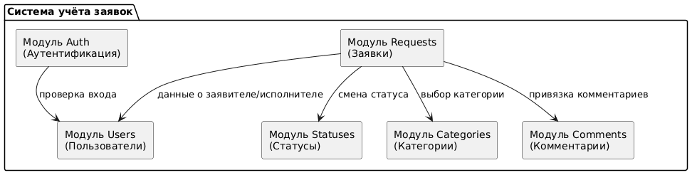

# Архитектура системы учёта заявок

## 1. Выбранный вариант: Слоистая архитектура (Layered Architecture)
Для учебного проекта выбрана слоистая архитектура. Она обеспечивает разделение ответственности, простоту тестирования и легкость понимания.

### Слои системы:
1. **Presentation (Controller)** — слой представления.
   * Ответственность: Принимает запросы от пользователя (UI/API), валидирует входные данные, возвращает ответы.
   * Запрещено: Писать SQL-запросы, принимать решения о статусах заявок.
2. **Service (Business Logic)** — слой бизнес-логики.
   * Ответственность: Реализует правила системы (например, проверка прав на смену статуса, автоматическое назначение приоритета). 
   * Запрещено: Рисовать интерфейс, работать напрямую с БД.
3. **Repository (Data Access)** — слой доступа к данным.
   * Ответственность: Чтение и запись данных в базу, выполнение CRUD-операций.
   * Запрещено: Принимать бизнес-решения.
4. **Database (БД)** — слой хранения.
   * Ответственность: Хранение данных (SQLite).
   * Запрещено: Содержать UI-логику.

## 2. Основные модули (компоненты)
* **Users** — управление пользователями и ролями.
* **Requests (Tickets)** — работа с заявками (создание, редактирование).
* **Statuses** — управление жизненным циклом заявки.
* **Categories** — справочник категорий заявок.
* **Comments** — комментарии к заявкам.
* **Auth** — аутентификация и авторизация.

## 3. Структура каталогов исходного кода (src/)
src/
├── controllers/     # Слой представления (обработчики запросов)
├── services/        # Бизнес-логика
├── repositories/    # Работа с БД (SQL-запросы)
├── models/          # Сущности (User, Request, Status, Category, Comment)
├── database/        # Подключение к SQLite, скрипты миграций
└── main.py          # Точка входа в приложение

## 4. Ключевые модули/классы и их назначение
1. **RequestController**
   * Назначение: Обработка HTTP-запросов по заявкам.
   * Входные данные: JSON с данными заявки.
   * Результат: Вызов RequestService, возврат JSON-ответа.
2. **RequestService**
   * Назначение: Бизнес-логика заявок (создание, смена статуса).
   * Входные данные: Данные от контроллера.
   * Результат: Объект заявки или ошибка.
3. **RequestRepository**
   * Назначение: Сохранение и извлечение заявок из БД.
   * Входные данные: SQL-параметры.
   * Результат: Строки из таблицы БД.
4. **UserService**
   * Назначение: Проверка прав пользователя перед действием.
   * Входные данные: ID пользователя, действие.
   * Результат: True/False (разрешено/запрещено).

## 5. Диаграммы
### Архитектурная диаграмма

### Диаграмма компонентов

